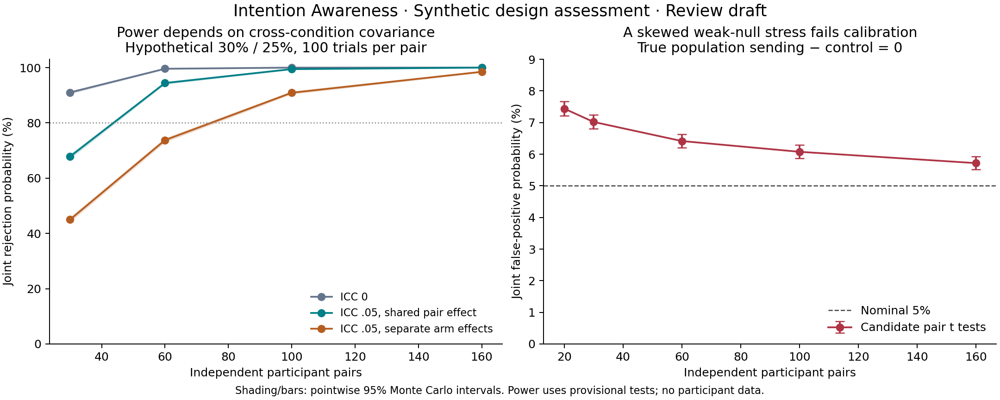

# Intention Awareness: simulation-based design assessment

26 October 2026 · v0.1 · **Review draft, synthetic observations only**

This package extends the [20 October refinement](https://akashicnet.org/downloads/intention-awareness/refinement-2026-10-20/protocol-refinement.html) and [22 October statistical addendum](https://akashicnet.org/downloads/intention-awareness/statistical-addendum-2026-10-22/statistical-addendum.html). It does not replace either record or change the [public proposal](https://akashicnet.org/intention-awareness). The earlier pair-level power illustration and response-preserving randomisation specifications already exist; this assessment adds dependence comparisons, partial-null calibration, allocation and omission scenarios, and operating characteristics for the sensitivities.

**Decision for review:** do not freeze a confirmatory sample size using the provisional pair t tests. Their power can be estimated under a model, but the skewed weak-null stress below shows that their nominal 5% level is not maintained across the assessed family. The simulations inform design choices; they do not validate the scientific hypothesis, testing platform or final analysis.

There are no real participants or experimental findings. The intention-awareness hypothesis remains **UNTESTED**. Preregistration, recruitment, participant testing, scientific promotion and website publication are not activated. No IONS endorsement is implied. No complete forthcoming IONS methods paper was incorporated or independently reviewed here; no claim is made about whether a new paper is now available. Private correspondence was not accessed or copied.

## Scientific question and decision rule

The narrow proposed scientific hypothesis is that, with ordinary communication blocked, receivers match an assigned four-action target **above 25% per scheduled sending trial and more often than against sealed no-sending targets**. Even a replicated effect would not isolate motor intention from target perception, imagery, other sender states or unnoticed ordinary cues.

For pair i, define S_i and C_i as scored exact hits divided by all scheduled sending and control trials. Omissions count as zero in this operational outcome. The equal-pair estimands are A = E(S_i) − .25 and Delta = E(S_i − C_i). Candidate nulls are A ≤ 0 and Delta ≤ 0. Both one-sided tests must reject at .05, with no favourable-sensitivity substitution. This is an intersection–union claim: control at .05 follows only if each true component null is actually controlled at .05. It does not follow from the AND rule alone.

The existing candidate tests are one-sample t tests on pair values S_i − .25 and S_i − C_i, using D−1 degrees of freedom. We assess those candidates, not a newly adopted primary test. Degenerate sample variance yields **no rejection** in this assessment; this conservative computational convention must be explicitly accepted or replaced before preregistration. Report descriptive values and flags; do not manufacture infinite t statistics. Confidence, impressions, relationship subgroups, response preferences and time trends remain exploratory. Marginal effect intervals are not simultaneous intervals, and simulation uncertainty intervals below are not participant effect intervals.

## Assumptions fixed for this assessment

These are AI-suggested planning assumptions, not observed parameters, user-approved design decisions or IONS effect estimates.

| Dimension | Assessed values | Interpretation |
| --- | --- | --- |
| Independent pairs D | 30, 60, 100, 160 | One person in one pair, fixed roles; operational feasibility not established |
| Scheduled trials per pair m | 40, 100, 200 | Two equal sessions; the existing 100-trial proposal remains the reference |
| Sending/control allocation | 50/50 throughout the main grid; 25/75 and 75/25 sensitivity | Exact counts within each session, randomly interleaved |
| Hypothetical completed-response rates | .28/.25, .30/.25, .35/.25 | Three-, five- and ten-percentage-point differences, not expected effects |
| Within-arm, within-pair Bernoulli ICC rho | 0, .02, .05 | Exact before omissions in the uniform random-effect surrogate; not empirical estimates |
| Cross-arm pair effects | Independent or fully shared latent effect | Two dependence endpoints, not a complete covariance family |
| Primary simulation repetitions | 20,000 per cell | 180 power, 160 uniform-effect calibration, 99 omission/allocation cells |
| Skewed weak-null stress | 50,000 per cell, five pair counts | Tests a distribution outside the symmetric power model |
| Randomisation study | 1,000 outer replicates × 999 draws, seven scenarios | 30 pairs × 40 trials; coarser computational study than a final analysis |

The 35-second cycle from the earlier refinement implies approximately 23, 58 or 117 minutes of trials per pair, before setup and breaks, for m=40, 100 or 200. Increasing m can introduce fatigue and carryover not represented in this surrogate. The 160-pair option is a planning scenario, not a demonstrated recruitment capacity.

### What “ICC” means here

For each pair and arm j, the main surrogate draws

`p_ij = p_j + sqrt(3 rho p_j (1−p_j)) U_ij`, with `U_ij ~ Uniform(−1,1)`.

Conditional on these probabilities, observations are Bernoulli. With n_j scheduled trials and no omissions,

`Var(arm mean_i) = p_j (1−p_j) [rho + (1−rho)/n_j]`.

The shared variant sets U_iS = U_iC, giving covariance `rho sqrt[p_S(1−p_S)p_C(1−p_C)]`; the independent variant sets that covariance to zero. Thus

`Var(S_i−C_i) = Var(S_i) + Var(C_i) − 2 Cov(S_i,C_i)`.

The same within-arm ICC can therefore give very different contrast precision. The ordinary cluster factor `1+(n−1)rho` equals 1.95 for n=20 and rho=.05, as in the task's illustration. It is not a plug-in multiplier for the whole paired, two-criterion design.

**Important boundary:** under genuinely independent uniform hidden targets and assignment-invariant responses, even strongly persistent biased guesses have an unconditional 25% match chance. Positive latent hit-rate ICC at a .25 mean is a deliberately broader **weak-mean-null stress surrogate**, not an assertion that repetitive blind guessing creates target information or nonzero hit ICC. Some latent pair rates fall below .25, modelling suppression as well as enhancement; these are mathematical stress cases, not a proposed mechanism. Only the separate sharp-null trial generator represents that clean target-independence null.



## What the synthetic calculations show

[RESULTS.md](RESULTS.md) gives generated tables with pointwise 95% Wilson Monte Carlo intervals. The CSVs in [results](results/) contain every cell, both component rejection rates, raw joint rejection, gate passage, gated success and completed-response comparisons. At 20,000 repetitions, worst-case Monte Carlo standard error is about .35 percentage points; it is about .15 points near a 5% rejection rate. These intervals are pointwise, with no simultaneous family coverage claim.

At 30% versus 25% and 100 scheduled trials per pair, candidate joint power for independent arm-specific effects with rho=.05 rises from **45.0% at 30 pairs** to **73.8% at 60**, **90.9% at 100** and **98.5% at 160**. Shared pair effects instead give **67.8%, 94.4%, 99.5% and approximately 100%**. The optimistic independent-observation results are also tabulated. These differences are consequences of the assumed covariance, not discoveries about participant ability.

With 6,000 total scheduled trials, 30 pairs × 200 trials gave 50.2% candidate joint power versus 73.8% for 60 pairs × 100, under rho=.05 and independent arm effects. At a three-point effect (.28/.25), even 160 pairs × 200 trials gave 79.4% (Monte Carlo interval 78.9–80.0%); the assessed grid does not securely clear 80% there.

Use the equal-total-trial comparisons to evaluate additional pairs versus additional trials. With arm-specific heterogeneity, increasing within-pair observations eventually leaves a pair-effect variance floor; more pairs can help more than longer sessions. Neither the 986-independent-trials benchmark nor a single ICC identifies a final sample. The 28%/25% cases show that a smaller worthwhile effect can materially change the required scale. No interpolation beyond the assessed grid is claimed.

### False-positive control: an explicit failure case

In the symmetric grid, contrast-test rejection at the .30/.30 boundary ranged from 4.68% to 5.46%, and chance-test rejection at the .25/.20 boundary from 4.53% to 5.18%. These pointwise simulation results do not establish universal control. An intentionally naive pooled independent-trial contrast rejected 25.04% of the time in the 30-pair, 200-trial, balanced .30/.30 case with rho=.05 and independent arm effects; it is a diagnostic, never an eligible primary analysis.

The symmetric calibration grid covers complete and partial-null boundaries: .25/.25, .30/.30, .25/.20 and .23/.25, with both allocations and dependence assumptions. Do not evaluate the joint claim only at .25/.25: when one criterion is clearly true and the other is at its null boundary, rejection can approach the size of the boundary component.

The adversarial skew test draws control probabilities .28 for 90% of pairs and .48 for 10%, while sending probability is .30 for every pair. The control population mean is exactly `.9×.28 + .1×.48 = .30`, hence **Delta=0**. This is a heterogeneous population weak null, not a sharp no-condition-effect null.

Across 50,000 synthetic repetitions per cell, the candidate joint false-positive rates were **7.44% at 20 pairs** (95% Monte Carlo interval 7.22–7.68%), **7.02% at 30**, **6.42% at 60**, **6.08% at 100** and **5.72% at 160**. The sending criterion is well powered here, exposing miscalibration in the contrast test. This failure is sufficient to withhold general calibration of the current candidate, even if symmetric scenarios look satisfactory.

`stress.py` also reports a very conservative independent-pair bounded-mean comparator: `exp[−D max(mean(S−C),0)^2/2]`. Differences lie in [−1,1]; the one-sided Hoeffding bound uses that range. It is an illustration of the precision cost of a distribution-free bound, not an adopted replacement or a sample-size recommendation. A replacement primary method needs a stated inferential target, independent statistical review and fresh joint-power assessment. Do not tune a cutoff on this grid and then describe the same grid as independent validation.

### Missing responses and integrity gates

The assessment retains scheduled denominators and equal pair weights. Missingness scenarios include:

- Independent 5% omissions in both arms.
- 1% sending versus 10% control omissions, independent of correctness within arm.
- 2% omission for all sending responses and control misses, but 40% for control hits: a deliberately target/outcome-dependent failure.
- 10% entire-pair loss before scoring, while retaining the planned denominator ledger where retention is authorised.

The earlier **proposed**, unadopted integrity rule is evaluated separately: more than 5% missing overall or an absolute arm difference above two percentage points makes a run feasibility-only. Report raw joint power, gate passage and their conjunction; never select only gate-passing datasets to report apparent power. A population omission rate right at 5% can fail the empirical gate about half the time. Completion planning needs a margin below the threshold.

For the 100-pair reference with .30/.25 completed rates, 5% independent omissions reduced raw candidate joint rejection to 86.2%, but only 51.2% of runs passed the proposed integrity gate and 44.2% passed both tests and the gate. With equal .30/.30 completed rates and 1%/10% differential omissions, raw joint rejection reached 49.5%; every such simulated run failed the proposed integrity gate.

Differential omissions can produce a scheduled-score sending advantage when completed-response rates are equal. This is not a type-I error for the *changed operational score mean*: it is a misleading route from score success to a scientific interpretation about information. Completed-response analysis helps describe the problem but does not repair outcome-dependent selection. In the code, an arm with no completed response for any pair blocks that completed-response joint result; pairs are not silently discarded.

Do not substitute zeroes for unrecoverable target logs or consent-required data deletion. Those cases are not ordinary response omissions and need their own preregistered contingency. Differential timing, compliance and eligibility decisions can have similar effects and are not licensed by these simulations.

## Response-preserving randomisation sensitivities

The existing addendum retains three distinct roles:

| Procedure | Fixed | Randomised support | Null/role |
| --- | --- | --- | --- |
| Conditional target shuffle | Responses, omissions, pair/session/condition, order | Target labels within pair × session × condition, observed target counts retained | Target-assignment invariance; sensitivity |
| Independent target redraw | Responses, masks and condition schedule | New independent uniform targets | Unconditional reference to the target generator |
| Condition shuffle | Targets, responses, masks, pair/session | Condition labels, exact 50/50 counts within each session | Sharp no-condition-effect null; separate sensitivity |

The code uses sufficient-statistic draws with exactly the same distribution as those shuffles. Conditional target matching allocates retained target counts to fixed response categories through sequential multivariate hypergeometric draws; ineligible rows remain in the support. Condition shuffling uses a hypergeometric draw of fixed hits into sending slots within each session. Equal arm sizes and equal schedules make the pooled count statistic's ordering identical to the equal-pair statistic. This shortcut is **not** valid unchanged for unequal schedules or alternative statistics. No unrestricted row shuffle is used.

Every p value uses inclusive ties and `(1+b)/(B+1)`, with identity assignments possible. B=999 gives resolution .001 and approximate standard error .0069 near p=.05, conditional on a dataset. Outer simulation intervals quantify additional dataset-to-dataset variability. The published 9,999-draw candidate is unchanged; a final analysis must freeze its own B and seeds. Running more draws does not fix a wrong null.

In the clean biased-guess null, target-shuffle rejection was 4.7% and condition-shuffle rejection 2.9% (pointwise Monte Carlo intervals 3.6–6.2% and 2.0–4.1%); these coarse finite/discrete checks do not establish universal calibration. With constant guesses, target-shuffle rejection was 0/1,000: its statistic was fixed by the conditioned margins. In the heterogeneous .30/.30 weak-null case, the condition sensitivity rejected in 10.5% of runs versus 5.1% for the candidate primary joint rule. The sharp condition null is false in that heterogeneous case; the result demonstrates the mismatch if one were to use this sensitivity as a weak-mean primary test.

The seven scenarios cover biased persistent guesses, constant guesses, assignment-independent omissions, an injected alternative, heterogeneous Delta=0, differential omissions and target-dependent omissions. Under a constant response within a stratum, target shuffling fixes the hit count: that sensitivity can be completely uninformative even while an unconditional target redraw varies. A failed sensitivity is not an alternative success path. Under heterogeneous effects or selective missingness, the corresponding sharp/invariance assumptions may be false; rejection frequencies there must not be presented as calibrated weak-null false-positive rates. Carryover, adaptive assignment and condition-linked software can invalidate fixed-sequence randomisation and remain outside this model.

The trial-level generator creates biased Markov responses independently of uniform targets for its clean null. For alternatives and weak-null stresses it forces matches or mismatches with probabilities chosen to achieve each latent hit rate; this is transparent synthetic information injection, not a psychological model. [synthetic-example.csv](synthetic-example.csv) preserves one unscreened illustrative ledger, seed 20261028: four fictional pairs, two sessions, 40 total trials per pair. Categories 0–3 stand for the four actions; eligible=0 is an omission/zero-score flag. The locked response value is retained behind that flag for synthetic inspection only; it is not an observed response in an actual omission.

## Decisions required before preregistration

| Choice | What must be fixed | This assessment's contribution |
| --- | --- | --- |
| Population and independent unit | Eligibility, unique people per pair, roles, representativeness and ethics | Assumes independent pairs only; reused participants require redesign |
| Smallest worthwhile effect | Completed and scheduled rates, meaningful A and Delta, acceptable precision | .03/.05/.10 differences are hypothetical, not selected thresholds |
| Primary inference | Population weak means or a design-based sharp null, test statistic, tails, zero-variance rule and uncertainty intervals | Demonstrates failure of the provisional t-test family under one skewed weak null |
| Final sample and allocation | Pair count, sessions, trials, arm proportions, enrollment/attrition closing rules | Conditional power grid only; no final sample approved |
| Dependence | Same-arm, cross-arm and session structure; skew and between-pair independence | Contrasts two covariance endpoints; no empirical ICC estimate |
| Missingness and eligibility | Late/absent responses, noncompliance, technical aborts, whole-pair withdrawal and data removal | Separates raw scores, completion and pragmatic integrity gates |
| Randomisation | Audited actual allocator, allowed sequences, carryover and masks | Evaluates only the stated uniform-target / exact within-session condition allocator |
| Sensitivity roles | Fixed B/seeds, ties, required reports; whether any becomes primary | Retains distinct roles; promotion would require a new design and power run |
| Stopping and reporting | Fixed sample, deadline, incomplete sample rule, null reporting, no favourable reruns | No sequential stopping or sample-size re-estimation assessed |
| Review and implementation | Independent statistics, ethics and software/leakage review | Synthetic code checks are not an experiment or platform audit |

A reasonable **next methods step**, not an adopted protocol, is to settle the weak-versus-sharp inferential target and review a replacement/calibrated primary approach before choosing a sample. If retaining a five-point planning effect and independent arm-specific rho=.05, 100 pairs × 100 trials is a useful planning reference because its current-model joint rejection exceeds 80%; it is **not a defensible final confirmatory sample while calibration is unresolved**. An empirically credible dependence/completion model, further distributional stress and the final test may change that scale.

## Reproduce and inspect

Use Python 3.11 or later; exact run versions are in [results/run.json](results/run.json). Install [requirements.txt](requirements.txt) in an isolated environment. All assessment code is local and has no network access or participant-input interface.

```sh
cd research/intention-awareness/design-assessment-2026-10-26
python -m pip install -r requirements.txt
python -m unittest discover -s . -p 'test_*.py' -v
python assessment.py --out reproduced --reps 20000 --perm-reps 1000 --draws 999
python stress.py --out reproduced/skew-calibration.csv --reps 50000
python prepare_review.py
python verify_package.py
```

Optional figure regeneration: install `matplotlib==3.10.8` and run `python make_figure.py`. The core numerical run does not require plotting dependencies.

`prepare_review.py` regenerates the review tables/example from the committed `results/` directory; it does not change numerical simulation outputs. To inspect a fresh run, compare its CSVs with the committed equivalents before replacing any reviewed results. Main and skew seeds are 20261026 and 20261027; four independent spawned main streams separate the power, calibration, omission/allocation and randomisation batches. Code is deterministic for the recorded dependency versions and stream order. Changing versions, grid ordering or draw counts may change exact bytes. Do not search seeds or rerun until significant.

The focused tests check analytic latent moments, independent/shared dependence, agreement with SciPy t values, exact small permutation distributions, masks, ties, degenerate cases and repeatability. The workflow runs those checks and a small **software smoke run**, not a statistically informative calibration. Pointwise Monte Carlo intervals do not certify universal type-I control.

Limitations not explored: intermediate/negative cross-arm dependence, explicit session effects, temporal carryover, learning/fatigue, informative pair selection, shared participants, adaptive scheduling, real leakage, participant-platform validation, consent deletion and an independently reviewed replacement primary test. These are recorded gaps, not assumed absent effects.

## Provenance and preservation

Base research repository: `tws9stmcbf-web/AkashicNET`, commit `e342c8fea7ef6da7ffe2a5efa8fca17de72df6a4`. No matching intention-assessment branch or title-matched PR was found during the bounded check. This new dated research package changes no website source, correction history, existing protocol download, canonical evidence record or promotion gate. Source access and limits are in [sources.json](sources.json). Direct website byte requests returned HTTP 403; the extracted public text was inspected through web retrieval, so no raw website hash verification is claimed.

User provenance: requested simulation-based design assessment and explicit preservation boundaries. AI-executed: public-source checks, code, synthetic runs, tests and draft research workflow integration. AI-suggested: modelling assumptions, interpretation and review priorities. No independent statistical approval has been obtained.

Method references: [Wu & Ding, Randomization Tests for Weak Null Hypotheses in Randomized Experiments](https://arxiv.org/abs/1809.07419) supports distinguishing sharp and weak nulls; this package does not implement their general weak-null procedure. [Phipson & Smyth, Permutation P-values Should Never Be Zero](https://doi.org/10.2202/1544-6115.1585) supports the finite Monte Carlo p-value convention. Neither reference endorses this proposal.
